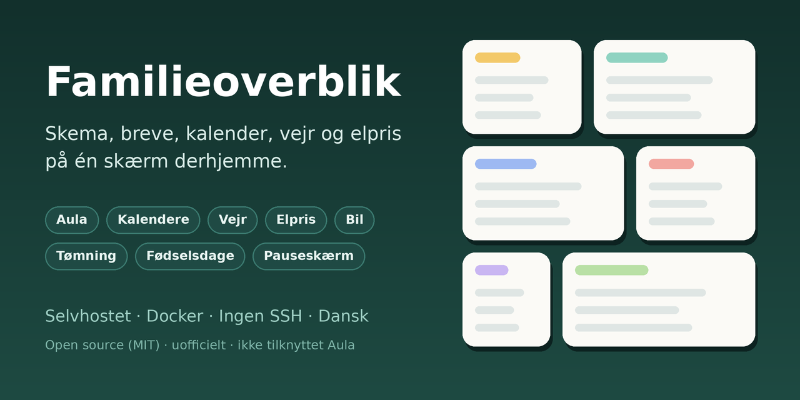
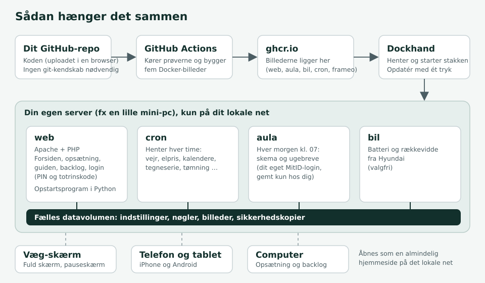

# Familieoverblik ("Family overview")

**School schedule, newsletters, calendars, weather and electricity prices on one screen at home.**
A self-hosted wall display and phone page for families, built for Danish parents who use **Aula** (the Danish school communication platform).

*[Dansk version](README.md)*

---

## What is it?

A small website that runs on your own server (for example a mini PC) and shows what the family needs every day on one page:
what the children have at school today, what the weekly newsletter says, when football practice is, what the weather is like, when electricity is cheapest, and when the bins go out.
Open it on a wall-mounted screen, a tablet or a phone; it can fill the whole screen.

It runs in Docker and is managed with [Dockhand](https://dockhand.pro), **without needing SSH access to the server**. Setup is a guide in your browser.

> **Unofficial project.** Familieoverblik is not made by, endorsed by or affiliated with Aula, UNI-C, MitID, Hyundai, Strava or Microsoft. See [Responsibility and limits](#responsibility-and-limits).

## Features

**On the front page**
- **Aula:** the children's schedule and weekly letters, and what needs a reply. Signs in with your own MitID (approved in the app, once).
- **Calendars:** any ICS calendar link, including Holdsport and DBU KampKlar (football), grouped per person.
- **Weather:** Open-Meteo (no key needed). Every third hour, colours by weather type, and wind with direction and gusts.
- **Electricity prices:** today's prices and the cheapest period (Energi Data Service), plus a "bars only" view.
- **Today with a day selector:** tap two days back and two days forward on the Today card (calendar, school, leisure, important and reminders); it returns by itself.
- **Wish lists:** a link per person to their list in Ønskeskyen (only for those who have a link).
- **Canteen:** the school's menu for the week, from the message the canteen sends, with today's dish highlighted.
- **Waste collection:** when each bin is emptied, with an icon for each waste type (also on the days in "Next days") and a reminder the evening before. You enter one date and a number of weeks, or **import a PDF collection calendar** (it is read in your own browser; also a calendar with symbols only, where you name the groups yourself).
- **Birthdays:** family birthdays, and **on the day** the screen gets the Danish flag, bunting and confetti.
- **Car, training, shopping:** battery and range from a Hyundai, Strava activities and the shopping list from Microsoft To Do (all optional).
- **Comic strip, joke of the day, notes and reminders.**
- **Screensaver** with the family's photos and a large clock.
- **Guest wi-fi** as a QR code, and a **random picker** (who does the dishes?) with your own lists.

**For whoever runs it**
- **Customise the layout:** move cards, make them narrow, half or wide, and hide the ones you do not want. Saved per device.
- **Colour themes:** light, warm, dark and high contrast, shared or **per device** (dark on the wall in the evening).
- **Danish, English and German**, and a button that translates the rest (letters, notes).
- **Browser check (`browser.html`):** shows whether an old device can run the pages, and an old browser gets a message instead of a blank page.
- **Full-screen button.** The pages need Chrome 85 or newer, so they should in principle run on older tablets (Android 5.1 can get Chrome 95), but this has not been tried on real devices.
- **A backlog page** where the family writes wishes, votes and comments.
- **Backup and restore** in the browser.

## Screenshots

<!-- ADD YOUR OWN SCREENSHOTS HERE, e.g. docs/skaermbilleder/forside.png. Hide children's names and personal data before sharing. -->
*No screenshots yet.*

## How it fits together

The code lives in your own GitHub repository. GitHub runs the tests and builds five Docker images, Dockhand pulls them, and four containers run on your server: **web** (the front page and settings), **cron** (fetches weather, prices and calendars every hour), **aula** (fetches schedule and letters every morning) and **car**. Everything is stored in one data volume on your own server.

## Getting started

You need: a server with Docker (a small mini PC is enough) and [Dockhand](https://dockhand.pro), a free GitHub account and a browser. Allow one to two hours the first time.

1. Create a private GitHub repository and upload the files from this folder.
2. Run **Actions → Byg billeder** (build images). GitHub runs the tests and builds the images.
3. Create a stack in Dockhand from `compose.yaml` and set `FAMILIE_REGISTER` to `ghcr.io/your-github-username`.
4. Open `http://your-server:8085`. The setup guide asks for a setup code that is printed in the web container's log.
5. Sign in to Aula once in the `aula` container's terminal and approve in the MitID app.

**The full step-by-step guide** is [GUIDE-V3.md](GUIDE-V3.md) (currently in Danish).

## Privacy and security

- **Everything stays with you.** Keys, PIN and Aula login are stored only on your own server (`private/`, never in GitHub or in the images).
- **PIN code**, and optionally **two-step verification** (authenticator app) and **recovery codes**. A device can be remembered for 7 to 365 days.
- **Open view** (optional, off by default): the front page can be seen without a PIN on a local network, while settings and backups still require the PIN.
- **Local network only.** The site runs over http. Do not put it directly on the internet; use a VPN to reach it from outside.
- External services contacted: Open-Meteo, Energi Data Service, GoComics, JokeAPI and (optionally) Strava, Microsoft Graph, Hyundai and Anthropic (only for "Translate page").

## Status

**Early release (version 3.x).** It has been running at one family's home since November 2026 (Docker on a mini PC, managed with Dockhand). The code is covered by **611 automated Python tests and 1,370 JavaScript tests**. What has been tried for real, and what only against simulations:
- **Aula:** the MitID login and fetching the schedule and weekly letters have been **tried by one family against Aula itself**. It uses an unofficial library and Aula's login can change, so it is the most fragile part. The schedule is read from the letter's table; it has run, but has not been checked against every class's letters. The canteen menu is not confirmed.
- **Only tried against simulations:** recurring events in calendars, reading a collection calendar that only shows symbols, open view and two-step verification. PHP, Apache and Docker themselves were not run in the test environment, so there may be bugs the tests cannot see.
- Services such as Hyundai, Strava and Open-Meteo can change and break part of the solution.

Please tell us what works and what does not (open an *issue*, but do not put children's names or letters in it).

## Responsibility and limits

- Use it at your own risk (the MIT licence gives no warranty). You are responsible for following the terms of the services you connect, including Aula. The program signs in with **your own** login and only fetches what you already have access to.
- It is not a supported product. Services used without official access may stop working without notice.
- Do not share screenshots, logs or backups without removing children's names and other personal data.

## Building on it

- [`CLAUDE.md`](CLAUDE.md): **handover notes**: where things are, rules, pitfalls and recipes (written so an AI assistant can continue without knowing the history; in Danish).
- [`BACKLOG.md`](BACKLOG.md) and [`CHANGELOG.md`](CHANGELOG.md): wishes, status and everything that changed.
- `python3 tests/alle.py` runs all tests. `python3 vaerktoej/pak.py` packages a release.

## Thanks to

[`aula`](https://pypi.org/project/aula/) (unofficial Aula library), [`hyundai-kia-connect-api`](https://pypi.org/project/hyundai-kia-connect-api/), [Open-Meteo](https://open-meteo.com/), [Energi Data Service](https://www.energidataservice.dk/), [JokeAPI](https://v2.jokeapi.dev/), [GoComics](https://www.gocomics.com/) and [Dockhand](https://dockhand.pro).

Built in collaboration with [Claude](https://www.anthropic.com/claude) (Anthropic). The family's wishes steered it, and everything is covered by automated tests.

## Licence

**Open source under the [MIT licence](LICENSE)**: you may use, change and share it freely, also for more than family use, as long as the licence text stays with it. There is no warranty. The libraries used and the terms of the services contacted are listed in [THIRD_PARTY.md](THIRD_PARTY.md) (Danish).
