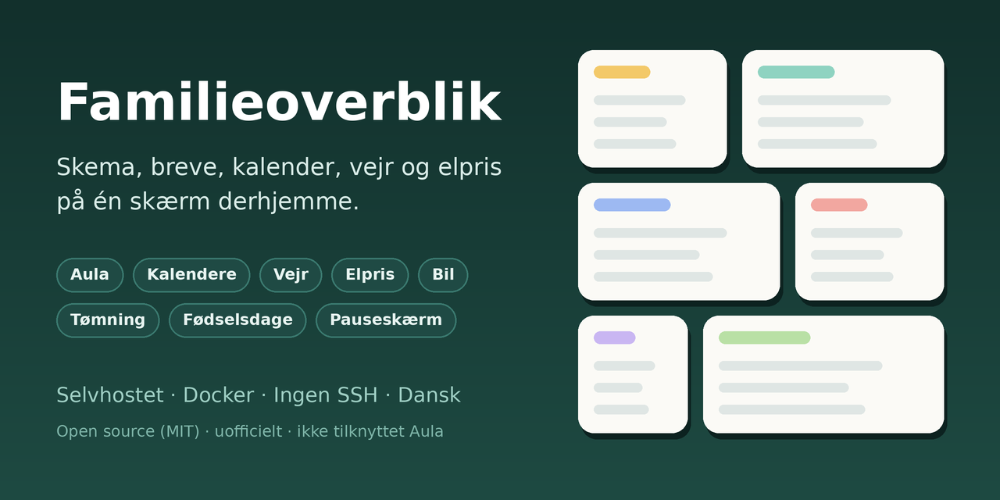
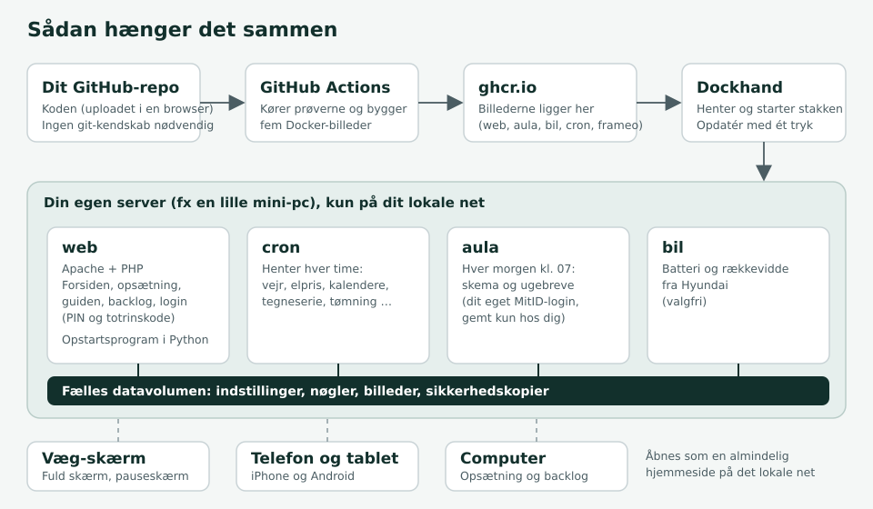

# Familieoverblik

**Skema, breve, kalender, vejr og elpris på én skærm derhjemme.**
En selvhostet væg-skærm og telefonside til familien, bygget til danske forældre med Aula.

*[English version](README.en.md)*

---

## Hvad er det?

Et lille website, der kører på din egen server (fx en mini-pc) og samler det, familien skal bruge hver dag, på én side:
hvad børnene skal i skole i dag, hvad der står i ugebrevet, hvornår der er fodbold, hvordan vejret er, hvornår strømmen er billigst, og hvornår skraldespanden skal ud.
Du åbner det på en væg-skærm, en tablet eller telefonen, og det kan fylde hele skærmen.

Det kører i Docker og styres med [Dockhand](https://dockhand.pro), **uden at du skal logge ind på serveren med SSH**. Selve opsætningen foregår i en guide i browseren.

> **Uofficielt projekt.** Familieoverblik er ikke lavet af, godkendt af eller tilknyttet Aula, UNI-C, MitID, Hyundai, Strava eller Microsoft. Se [Ansvar og begrænsninger](#ansvar-og-begrænsninger).

## Det kan den

**På forsiden**
- **Aula:** børnenes skema og ugebreve, og hvad der kræver svar. Logger ind med dit eget MitID (godkendes i appen, første gang).
- **Kalendere:** alle kalenderlinks (ICS), også Holdsport og DBU KampKlar, samlet pr. person.
- **Vejr:** Open-Meteo (uden nøgle). Hver tredje time, farver efter vejrtype og vind med retning og stød.
- **Elpris:** dagens priser og billigste periode (Energi Data Service), og et «kun søjler»-valg.
- **Tømning:** hvornår hver skraldespand tømmes, og en påmindelse aftenen før. Du skriver én dato og et antal uger, resten regnes ud.
- **Fødselsdage:** familiens fødselsdage, og **på dagen** får skærmen Dannebrog, flagguirlande og konfetti.
- **Bil, træning, indkøb:** batteri og rækkevidde fra en Hyundai, Strava-aktiviteter og indkøbslisten fra Microsoft To Do (alle valgfri).
- **Tegneserie, dagens joke, noter og huskepunkter.**
- **Pauseskærm** med familiens billeder og et stort ur.
- **Gæste-wifi** som QR-kode, og en **tilfældig vælger** (hvem skal vaske op?) med egne lister.

**Til dig, der styrer det**
- **Tilpas layout:** flyt kortene, gør dem smalle, halve eller brede, og skjul dem, du ikke vil se. Valget gemmes pr. enhed.
- **Farvetemaer:** lys, varm, mørk og høj kontrast, fælles eller **pr. enhed** (mørkt på væggen om aftenen).
- **Dansk, engelsk og tysk**, og en knap, der oversætter resten (breve, noter).
- **Fuld skærm-knap.** Siderne kræver Chrome 85 eller nyere, så de kan i princippet køre på ældre tablets (Android 5.1 kan få Chrome 95), men det er ikke afprøvet på rigtige enheder.
- **Backlog-side**, hvor familien selv kan skrive ønsker, stemme og kommentere.
- **Sikkerhedskopi og gendannelse** i browseren.

## Sådan ser det ud

<!-- TILFØJ DINE EGNE SKÆRMBILLEDER HER, fx docs/skaermbilleder/forside.png. Skjul børns navne og private oplysninger, før du deler dem. -->
*Der er endnu ikke lagt skærmbilleder ind. Forsiden er opbygget af kort i en kolonne og brede kort ved siden af.*

## Sådan hænger det sammen

Koden ligger i dit eget GitHub-repo. GitHub bygger fem Docker-billeder (og kører prøverne først), Dockhand henter dem, og fire containere kører på din server: **web** (forsiden og opsætningen), **cron** (henter vejr, elpris og kalendere hver time), **aula** (henter skema og breve hver morgen) og **bil**. Alt gemmes i ét datavolumen på din egen server.

## Kom i gang

Du skal bruge: en server med Docker (en lille mini-pc er nok) og [Dockhand](https://dockhand.pro), en gratis GitHub-konto og en browser. Regn med en til to timer første gang.

1. Opret et privat repo på GitHub, og upload filerne fra denne mappe.
2. Kør **Actions → Byg billeder**. GitHub kører prøverne og bygger billederne.
3. Opret en stak i Dockhand med `compose.yaml`, og sæt `FAMILIE_REGISTER` til `ghcr.io/dit-github-brugernavn`.
4. Åbn `http://serverens-adresse:8085`. Guiden i browseren beder om en opsætningskode, som står i web-containerens log.
5. Log ind på Aula (en gang) i `aula`-containerens terminal, og godkend i MitID-appen.

**Den fulde trin-for-trin-guide:** [GUIDE-V3.md](GUIDE-V3.md) (og en udgave til Notepad++ i hver udgave).

## Privatliv og sikkerhed

- **Alt ligger hos dig.** Nøgler, PIN og Aula-login gemmes kun på din egen server (`private/`, aldrig i GitHub eller i billederne).
- **PIN-kode**, og valgfrit **totrinsbekræftelse** (autentificeringsapp) og **gendannelseskoder**. En enhed kan huskes i 7 til 365 dage.
- **Åben visning** (valgfri, slået fra som standard): forsiden kan ses uden PIN på et lokalt net, mens indstillinger og sikkerhedskopi stadig kræver PIN.
- **Kun til dit eget net.** Siden kører over http. Sæt den ikke direkte på internettet. Vil du nå den hjemmefra, så brug en VPN.
- Eksterne tjenester, der kontaktes: Open-Meteo, Energi Data Service, GoComics, JokeAPI og (valgfrit) Strava, Microsoft Graph, Hyundai og Anthropic (kun til «Oversæt siden»).

## Status

**Tidlig udgave (version 3.x).** Koden er afprøvet med **396 automatiske Python-prøver og 1.027 JavaScript-prøver**, men ikke alt er prøvet mod de rigtige tjenester:
- **Aula-login** bruger et uofficielt bibliotek og er prøvet mod en simulering, ikke mod Aula. Det er den mest skrøbelige del.
- **PHP, Apache og Docker** er ikke kørt i udviklingsmiljøet, så login, totrinsbekræftelse og åben visning skal prøves på en rigtig server.
- Tjenester som Hyundai, Strava og Open-Meteo kan ændre sig og dermed bryde en del af løsningen.

Fortæl gerne, hvad der virker og ikke virker (opret et *issue*).

## Ansvar og begrænsninger

- Brug det på eget ansvar (MIT-licensen giver ingen garanti). Du er selv ansvarlig for at overholde vilkårene hos de tjenester, du forbinder, herunder Aula. Programmet logger ind med **dit eget** login og henter kun det, du selv har adgang til.
- Det er ikke et produkt med support. Tjenester, løsningen bruger uden officiel adgang, kan holde op med at virke uden varsel.
- Del ikke skærmbilleder, logfiler eller sikkerhedskopier uden at fjerne børns navne og andre personoplysninger.

## Til dig, der vil bygge videre

- [`CLAUDE.md`](CLAUDE.md): **overdragelse**: hvor tingene ligger, regler, faldgruber og opskrifter (skrevet, så en AI-assistent kan bygge videre uden at kende historien).
- [`BACKLOG.md`](BACKLOG.md) og [`CHANGELOG.md`](CHANGELOG.md): ønsker, status og alt, der er ændret.
- `python3 tests/alle.py` kører alle prøver. `python3 vaerktoej/pak.py` pakker en udgave.

## Tak til

[`aula`](https://pypi.org/project/aula/) (uofficielt bibliotek til Aula), [`hyundai-kia-connect-api`](https://pypi.org/project/hyundai-kia-connect-api/), [Open-Meteo](https://open-meteo.com/), [Energi Data Service](https://www.energidataservice.dk/), [JokeAPI](https://v2.jokeapi.dev/), [GoComics](https://www.gocomics.com/) og [Dockhand](https://dockhand.pro).

Bygget i samarbejde med [Claude](https://www.anthropic.com/claude) (Anthropic). Familiens ønsker styrede, og alt er afprøvet med automatiske prøver.

## Licens

**Open source under [MIT-licensen](LICENSE)**: du må bruge, ændre og dele det frit, også til andet end familiebrug, så længe licensteksten følger med. Der er ingen garanti. Bibliotekerne, løsningen bruger, og vilkårene hos de tjenester, den kontakter, står i [THIRD_PARTY.md](THIRD_PARTY.md).
